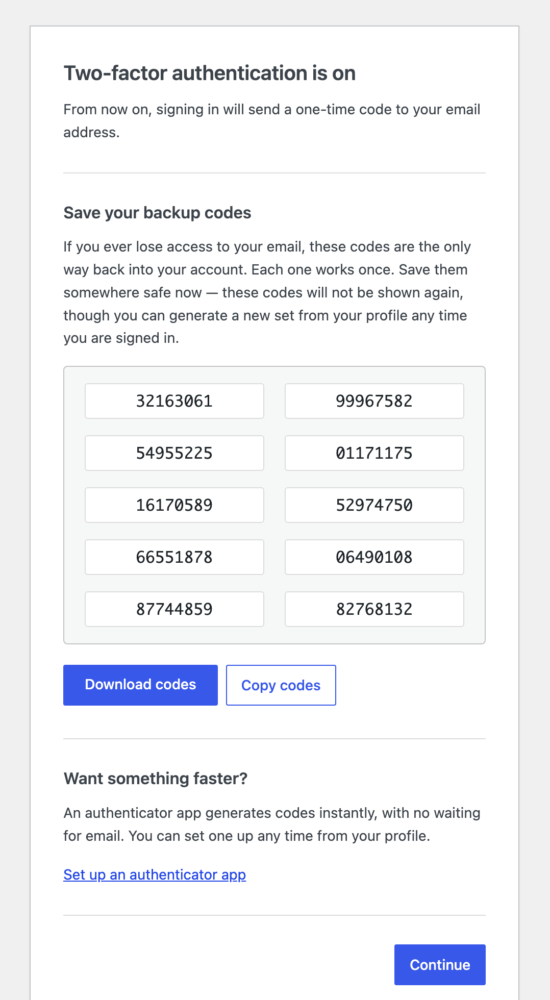

# Two-Factor Enrollment

An add-on for the [Two Factor](https://wordpress.org/plugins/two-factor/) plugin
that enrolls policy-covered users in two-factor authentication **before an auth
cookie is issued**.

Implements the onboarding flow described in
[WordPress/two-factor#813](https://github.com/WordPress/two-factor/issues/813).



## What it does

When a covered user logs in without a second factor configured, this plugin adds
the Email provider to their account at runtime. Two Factor's existing login
challenge then emails them a one-time code and withholds the auth cookie until
they enter it. Confirming the code proves mailbox control and completes
enrollment in a single step.

Enrollment is only made permanent — written to the user's enabled providers —
once they actually pass the emailed challenge. If a covered user never logs in
after this plugin is installed, or if it's deactivated first, nothing is written
and no trace is left. Once enrollment does complete, an account-change
notification is emailed (see `two_factor_enrollment_notify` below), and they're
redirected to a one-time onboarding screen, where backup codes are generated
and enabled for them and they're offered a link to set up an authenticator
app.

In the ordinary case that redirect happens within the same login, right after
they enter the emailed code and before they reach the dashboard. It is driven
by the `login_redirect` filter, so it does not happen on an **interim login**
— the small re-authentication modal WordPress shows when a session expires
mid-edit. Two Factor returns before `login_redirect` on that path. The user
stays enrolled either way; they simply meet the onboarding screen at their
next full login instead.

A user who is both required and marked deferrable is skipped entirely on that
login — Email is not injected, and they proceed normally. This plugin stores
no counters or deadlines for deferral; it only asks the policy layer's filter
and honors the answer each time.

### Onboarding is scoped to users this plugin enrolled

The onboarding screen only ever appears for a user this plugin itself enrolled.
Internally this is tracked with a tri-state user meta value
(`_two_factor_enrollment_onboarded`: absent, `pending`, or `done`) rather than a
boolean, specifically so that "never enrolled by this plugin" and "already saw
the screen" are both distinguishable from "owed the screen." A user who
configured TOTP (or any other provider) before this plugin was ever installed
is never diverted to a screen they never asked for.

### The onboarding screen enables backup codes, not just displays them

If the user has no backup codes yet, the onboarding screen generates a set and
appends `Two_Factor_Backup_Codes` to their enabled providers, so the codes it
shows are immediately usable as a real login method — not a preview. They can
be downloaded as a text file from the screen. Their primary provider stays
Email. If an administrator has disabled the Backup Codes provider site-wide,
this section is skipped.

That particular set of codes is shown once and not again, but this is not the
user's last chance at recovery codes: anyone who is signed in can generate a
fresh set from `profile.php` whenever they like.

### The onboarding screen is authorized by a one-time token

Rendering the screen changes state — it generates backup codes, enables the
provider, and consumes itself — so the link carries a one-time token, minted
with the pending marker and destroyed when the screen completes. A request
without the matching token is passed straight through to the user's
destination, generating nothing and consuming nothing. (A WordPress nonce
cannot do this job: `wp_create_nonce()` folds the session token into its hash,
and `wp_set_auth_cookie()` does not populate `$_COOKIE` within the request that
mints the link, so such a nonce would fail verification every time.)

## Security

The property this design rests on is where the auth cookie sits in the login
sequence: `Two_Factor_Core` validates the emailed code first and only calls
`wp_set_auth_cookie()` after that succeeds — never on the strength of the
password alone. (The permanent record of enrollment — appending Email to the
user's enabled providers — is written a moment later in that same request,
once the code has already been proven; it plays no part in gating the
cookie.)

- No password-only session is ever created for a covered user. There is
  nothing to lock down between "password verified" and "second factor set up,"
  because that window doesn't exist — the auth cookie is never issued until
  the emailed code is entered and validated.
- This closes the **enrollment race**: an attacker who has obtained only a
  user's password cannot pass that validation, because they cannot receive the
  emailed one-time code. Passwords alone stop being sufficient to take over an
  account through the login form, including an account that had no second
  factor configured yet. That qualifier matters: this covers interactive
  logins only, and an **application password** remains sufficient on its own
  for the REST and XML-RPC surface — Two Factor governs those separately, via
  `two_factor_user_api_login_enable`.
- The required path deliberately offers **no provider chooser**. If a user
  could pick a method other than Email, an attacker could try to steer
  enrollment toward a factor that doesn't depend on the mailbox. Removing the
  choice is what makes the mailbox requirement actually load-bearing.

## What it does not do

It owns **no enforcement policy**. It has no settings screen and no role
targeting. Both contract filters (`two_factor_enrollment_required` and
`two_factor_enrollment_deferrable`) default to `false`, so installing it alone
changes nothing. Something else decides who must enroll — for example a
companion policy plugin, or a few lines in a theme or mu-plugin.

## Usage

The plugin does nothing until something answers `two_factor_enrollment_required`.
By default no one is required to enroll and no one may defer, so an install with
no policy callback registered is a permanent no-op.

### Where the policy lives

Put it in `wp-content/mu-plugins/`. Must-use plugins cannot be deactivated from
the admin, which matters when the whole point is that covered users cannot opt
out.

```php
<?php
/**
 * Plugin Name: Two-Factor Enrollment Policy
 * Description: Decides who must enroll in two-factor authentication.
 */

add_filter( 'two_factor_enrollment_required', function ( $required, $user ) {
	return user_can( $user, 'edit_posts' );
}, 10, 2 );
```

That covers everyone who can publish — administrators, editors, authors,
contributors — and leaves subscribers and customers alone.

Other predicates follow the same shape:

| Who must enroll | Predicate |
|---|---|
| Everyone | `true` |
| Administrators only | `user_can( $user, 'manage_options' )` |
| Specific roles | `(bool) array_intersect( array( 'administrator', 'editor' ), (array) $user->roles )` |
| Everyone except a service account | `'svc-integration' !== $user->user_login` |

### Staged rollout

This is what the deferral filter is for: require enrollment for everyone, but
let most people defer it until a later date while a smaller group enrolls
immediately.

```php
add_filter( 'two_factor_enrollment_required', '__return_true', 10, 2 );

add_filter( 'two_factor_enrollment_deferrable', function ( $allowed, $user ) {
	// Admins enroll now; everyone else can defer until the deadline.
	if ( user_can( $user, 'manage_options' ) ) {
		return false;
	}
	return time() < strtotime( '2026-09-01' );
}, 10, 2 );
```

A user who is currently allowed to defer logs in entirely normally — no
challenge, no screen, nothing to notice — and enrolls on their next login once
the condition flips. This plugin stores no deferral state of its own, which is
exactly why the condition can be a date, a login count, or per-user meta
without it knowing anything about it.

### Before switching it on

Mail must work, because the second factor **is** the email: if transactional
mail is broken, every covered user is locked out at their next login. Test
delivery to a real mailbox first, and keep a known-good administrator session
open while you roll out. If [Require Email 2FA](#compatibility-with-require-email-2fa)
is also active on the site, deactivate it or scope the two so they do not
overlap — running both means neither one's rollout logic actually runs.

### Observing enrollment

`two_factor_enrollment_enrolled` fires once per user, the moment this plugin
permanently enrolls them — see the [Filters](#filters) table below for its full
signature. During a rollout that is a convenient hook for a log line or a
dashboard counter:

```php
add_action( 'two_factor_enrollment_enrolled', function ( $user, $provider ) {
	error_log( sprintf( 'Enrolled %s via %s', $user->user_login, $provider->get_key() ) );
}, 10, 2 );
```

## Filters

| Filter | Default | Purpose |
|---|---|---|
| `two_factor_enrollment_required` | `false` | Does this user have to enroll |
| `two_factor_enrollment_deferrable` | `false` | May this user skip enrollment on this login |
| `two_factor_enrollment_notify` | `true` | Send the enrollment notification email |

There is also one action:

| Action | Arguments | Fires |
|---|---|---|
| `two_factor_enrollment_enrolled` | `WP_User $user`, `Two_Factor_Provider $provider` | Once, when this plugin has permanently enrolled a user |

Deferral counting and deadlines belong to the policy layer, and this plugin
persists none of that state — so `two_factor_enrollment_enrolled` is how the
policy layer learns it can stop counting. It fires only for a genuinely new
enrollment, never on a repeat login.

```php
add_action(
	'two_factor_enrollment_enrolled',
	function ( $user ) {
		delete_user_meta( $user->ID, 'my_plugin_enrollment_deferrals' );
	}
);
```

### Your policy callback may call back into Two Factor

`two_factor_enrollment_required` and `two_factor_enrollment_deferrable` both run
from inside this plugin's `two_factor_enabled_providers_for_user` filter, so the
obvious way to write "require two-factor for users who don't have it" —
`! Two_Factor_Core::is_user_using_two_factor( $user )` — re-enters that same
filter. That is supported: the injection is guarded against reentrancy, and the
inner call returns the user's **stored** providers, unmodified by any injection
this plugin is about to make. In other words your callback sees the honest
answer to "does this user already have a second factor?", not a view of the
world this plugin has already edited.


## Requirements

WordPress 6.5+, PHP 7.2+, and the Two Factor plugin.

## Limitation

If an administrator disables the Email provider site-wide, this plugin stands
down and shows an admin notice. Enrolling users into a non-Email provider
requires configuration after login, which needs a session — see
[WordPress/two-factor#934](https://github.com/WordPress/two-factor/issues/934).

## Compatibility with Require Email 2FA

[Require Email 2FA](https://github.com/dknauss/Require-Email-2FA) solves the same
problem a different way, and the two do **not** compose — running both gives you
Require Email 2FA's behavior and none of this plugin's.

Both hook `two_factor_enabled_providers_for_user` at priority 10. WordPress
runs same-priority callbacks in the order their `add_filter()` calls were
registered, which for two plugins hooking on `plugins_loaded` (or earlier)
follows their order in `active_plugins` — so this behavior holds only when
Require Email 2FA is active and sorts ahead of Two-Factor Enrollment in that
list, which is the case whenever both are simply activated in a typical
install. Given that ordering, Require Email 2FA enables the Email provider for
every user it covers before this plugin's gate runs, so the gate sees Email
already in the list and correctly leaves it alone: no enrollment is recorded,
no onboarding screen is shown, no backup codes are generated, and no
notification is sent. If that order were ever reversed — deliberately, via a
priority change, or by a loader that does not follow `active_plugins` order —
Two-Factor Enrollment's gate would run first instead, and the two plugins
would no longer agree on which one governs a given login. They are not
designed to be reordered relative to each other; treat this as one plugin
winning by default, not as a coordination contract between them.

They are alternatives rather than layers:

|  | Require Email 2FA | Two-Factor Enrollment |
|---|---|---|
| How the second factor arrives | Enabled silently for everyone covered | User completes an emailed challenge at login |
| Mailbox proven? | No — enabled whether or not mail works | Yes, before enrollment is recorded |
| Recovery codes | Not provided | Generated, enabled, and shown once |
| User is told | No | Yes, by email |
| Rollout friction | None | One extra step at next login |

Require Email 2FA trades consent for a frictionless rollout with no lockout risk
at switch-on. This plugin trades a login-time interaction for a proven mailbox
and a working recovery path. Pick the one that suits the site.

To move from one to the other, deactivate Require Email 2FA and express its
coverage as a policy filter here. Its `force_2fa_excluded_roles` list inverts
into an inclusion predicate:

```php
add_filter(
	'two_factor_enrollment_required',
	function ( $required, $user ) {
		$excluded = array( 'subscriber' ); // whatever FORCE_2FA_EXCLUDED_ROLES held
		return ! array_intersect( $excluded, (array) $user->roles );
	},
	10,
	2
);
```

## Uninstalling

The only state this plugin persists of its own is the single
`_two_factor_enrollment_onboarded` user meta key. Uninstalling removes that key
from every user who has it. It deliberately does **not** touch the Two Factor
plugin's own data — enabled providers, backup codes, and so on — because that
data belongs to the dependency and may still be in active use.

## License

GPL-2.0-or-later.
